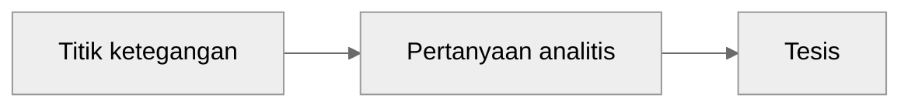

## Sebelum Menulis Esai 

kita harus pertanyaan analitis. 

Pertanyaan analitis dapat ditemukan pada ketegangan-ketegangan yang ada di dalam tulisan. 

Bagaimana cara menemukan ketegangan tulisan?

1. argumen yang tampak tidak meyakinkan. Dapat dipersoalkan dengan menanyakan apa yang kurang dari argumen tersebut, atau bukti-bukti apa yang masih belum dipertimbangkan dalam argumen tersebut.
2. inkonsistensi dan kekaburan bukti-bukti dalam tulisan.
3. hal tak terduga yang perlu mendapat perhatian lebih.
4. kesimpulan tak terduga yang tampak kurang masuk akal.
5. kontroversi yang perlu dibahas.
6. sesuatu yang diabaikan padahal kita rasa itu perlu ditinjau lebih dalam

### Tips

* pertanyaan analitis biasanya ada pada pertanyaan dengan "mengapa" dan "bagaimana" 
* pertanyaan analitis yang bagus adalah pertanyaan yang mampu menggarisbawahi pola-pola/hubungan, kontradiksi/dilemma/dan masalah 
* pertanyaan analitis memberikan batasan dari ranah argumenmu

## Tesis

Tesis Anda adalah klaim utama dalam esai yang terdiri dari wawasan atau gagasan utamamu tentang masalah tertentu. 

esai akademis biasanya memunculkan tesisnya di awal, diikuti oleh argumen yang disusun secara logis yang mendukung klaim utama ini. 

Tesis yang kuat adalah tesis yang dapat diperdebatkan, yang berarti pembaca dapat tidak setuju dengannya dan oleh karena itu membutuhkan analisis bukti yang cermat untuk memahami bagaimana esaimu sampai pada klaim ini.

Tesis dapat ditempuh dengan memeriksa dan menganalisis bukti yang tersedia, yang mungkin berupa teks atau jenis materi sumber lainnya.

---

Ketika merumuskan pertanyaan atau masalah tersebut untuk pembaca, kamu mesti berusaha untuk memberi tahu mereka mengapa pertanyaan Anda penting dan mengapa mereka harus peduli dengan jawabanmu. Jika kamu dapat menjelaskan kepada pembaca mengapa suatu pertanyaan atau masalah layak untuk dibahas, maka mereka akan memahami mengapa layak membaca esai yang mengembangkan tesis Anda—dan Anda akan memahami mengapa layak menulis esai tersebut.

### Pertanyaan penting soal tesis yang sudah kamu buat

• Apakah tesis tersebut benar-benar dapat diperdebatkan? Apakah tesis tersebut membahas dilema yang nyata dalam sumber, atau apakah sebagian besar pembaca akan secara otomatis setuju dengannya?
• Apakah tesis tersebut terlalu jelas? Sekali lagi, apakah sebagian besar atau semua pembaca akan setuju dengannya tanpa perlu melihat argumen Anda?
• Apakah tesis tersebut cukup kompleks sehingga membutuhkan argumen sepanjang esai?
• Apakah tesis tersebut dapat didukung dengan bukti dari teks, bukan dengan generalisasi atau penelitian dari luar?
• Apakah ada yang ingin membaca makalah yang mengembangkan tesis ini? Artinya, dapatkah Anda menjelaskan apa yang ditambahkan makalah ini pada pemahaman kita tentang suatu masalah, pertanyaan, atau topik?

## Bagian Pendahuluan

bagian Pendahuluan memberikan kesempatan untuk menjelaskan kepada pembaca tentang isi esai Anda dan mengapa mereka harus tertarik membacanya. Anda tidak perlu "memikat/hook" pembaca dengan janji dramatis (setiap diskusi lain tentang topik yang Anda tulis sepenuhnya salah!) atau fakta menarik (bulan dapat mencapai suhu 127 derajat Celcius!). Sebaliknya, Anda harus menggunakan pendahuluan untuk menjelaskan kepada pembaca mengapa esai Anda akan menarik untuk dibaca. Untuk melakukan ini, Anda perlu merumuskan pertanyaan atau masalah yang Anda tulis dan menjelaskan mengapa pertanyaan atau masalah ini penting. Jika Anda memberikan alasan yang meyakinkan mengapa pertanyaan atau masalah Anda layak dipecahkan, pembaca Anda akan tertarik untuk membaca lebih lanjut.

Secara umum, pendahuluan esai memuat beberapa poin berikut:

1. Menyampaikan informasi pengantar

   Saat menulis esai, akan sangat membantu jika Anda memikirkan apa yang perlu diketahui pembaca agar dapat mengikuti argumen Anda. Pendahuluan Anda harus mencakup informasi yang cukup agar pembaca dapat memahami konteks tesis Anda.

   Sebagai contoh, jika Anda menganalisis argumen orang lain, Anda perlu mengidentifikasi argumen tersebut dan mungkin meringkas poin-poin utamanya. Jika Anda bergabung dalam percakapan ilmiah tentang reformasi pendidikan, Anda perlu memberikan konteks untuk percakapan ini sebelum menjelaskan apa yang ditambahkan esai Anda pada diskusi tersebut.

2. Penjelasan tentang apa yang dipertaruhkan dalam esai Anda, atau mengapa orang perlu membaca esai yang membahas tesis ini.

   Anda akan tahu mengapa esai Anda layak ditulis jika Anda mencoba menjawab pertanyaan yang tidak memiliki jawaban yang jelas; untuk mengusulkan solusi untuk masalah tanpa satu solusi yang jelas; atau untuk menunjukkan sesuatu yang mungkin tidak diperhatikan orang lain yang mengubah cara kita mempertimbangkan suatu fenomena, sumber, atau ide. Dalam semua kasus ini, Anda akan mencoba memahami sesuatu yang menurut Anda berharga untuk dipahami. Tetapi tidak cukup hanya mengetahui mengapa esai Anda layak dibaca.

3. Tesis

## Badan Tulisan

Paragraf yang kuat dalam esai akademis biasanya mencakup tiga elemen ini:

* Kalimat topik. Kalimat topik memiliki fungsi ganda untuk sebuah paragraf. Pertama, kalimat topik yang kuat membuat klaim atau menyatakan ide utama yang kemudian dikembangkan di bagian paragraf selanjutnya. Kedua, kalimat topik memberi sinyal kepada pembaca bagaimana paragraf tersebut terhubung dengan argumen yang lebih besar dalam makalah Anda.

  Berikut adalah contoh kalimat topik dari makalah karya Laura Connor ‘23 yang menganalisis retorika yang digunakan oleh Frederic Douglass, Mary Wollstonecraft, dan Karl Marx. Dalam makalahnya, Connor berpendapat bahwa retorika Marx paling efektif dalam mendorong perubahan sosial.

  > Dalam banyak tulisannya, Marx mengkritik kapitalisme dengan mengidentifikasi kekurangannya.

  Kalimat topik ini membuat klaim yang kemudian perlu didukung dengan bukti: pembaca dapat mengharapkan bahwa kalimat tersebut akan diikuti oleh diskusi tentang apa yang dilihat Marx sebagai kekurangan dalam kapitalisme, yang pada gilirannya akan membantu mereka memahami tesis Connor tentang bagaimana ketiga penulis ini menggunakan retorika mereka untuk memengaruhi perubahan sosial.

* Bukti. Setelah Anda membuat klaim dalam kalimat topik Anda, Anda perlu membantu pembaca Anda melihat bagaimana Anda sampai pada klaim tersebut dari bukti yang Anda periksa. Bukti tersebut dapat mencakup kutipan atau materi yang diparafrasekan dari suatu sumber, atau dapat mencakup data, hasil, atau materi sumber primer. Dalam paragraf yang mengikuti kalimat topik Connor di atas, ia menawarkan beberapa kutipan dari Marx yang menunjukkan bagaimana ia memandang kekurangan dalam kapitalisme.

* Analisis. Tidak cukup hanya memberikan bukti untuk mendukung suatu klaim. Anda harus memberi tahu pembaca Anda apa yang Anda ingin mereka pahami tentang bukti tersebut. Dengan kata lain, Anda harus menganalisisnya. Bagaimana bukti ini mendukung klaim Anda? Dalam paragraf Connor, ia mengikuti penyajian buktinya dengan kalimat-kalimat yang memberi tahu pembaca apa yang perlu mereka pahami tentang bukti tersebut—khususnya bahwa bukti tersebut menunjukkan bagaimana Marx menunjukkan kekurangan dalam kapitalisme tanpa memberi tahu pembacanya sendiri apa yang harus dipikirkan tentang hal itu, dan bahwa ini adalah strateginya.

Cobalah untuk mengakhiri paragraf dengan kalimat yang memberi tahu pembaca sesuatu yang sekarang dapat mereka pahami karena mereka telah membaca paragraf Anda. (tidak harus dengan ”di sini kita tahu”) Dalam paragraf Connor, kalimat terakhir tidak merangkum semua klaim spesifik Marx, tetapi malah memberi tahu pembaca apa yang dapat mereka ambil dari bukti tersebut. Setelah melihat apa yang dikatakan Marx tentang kapitalisme, Connor menjelaskan apa yang disarankan oleh bukti yang baru saja dia berikan tentang keyakinan Marx.

## Transisi Antar Paragraf

Pengulangan kata dalam paragraf baru membantu pembaca melihat hubungan antara apa yang telah dibahas sebelumnya dan apa yang akan datang berikutnya.

Apa saja transisi yang biasanya digunakan?

* Membuat perbandingan atau menunjukkan kontras.

  Kata-kata transisi yang membandingkan dan membedakan meliputi *begitu halnya, dengan cara yang sama, serupa, sebaliknya, namun, di satu sisi, di sisi lain.* Tetapi sebelum Anda memberi sinyal perbandingan, ajukan pertanyaan-pertanyaan ini: Apakah pembaca Anda membutuhkan contoh lain dari hal yang sama? Adakah nuansa baru dalam poin berikutnya yang membedakannya dari contoh sebelumnya? Untuk hubungan antar ide tersebut, Anda dapat mencoba jenis transisi ini: Meskipun x mungkin tampak sama, sebenarnya hal itu menimbulkan pertanyaan baru dengan cara yang sedikit berbeda.

* Menyatakan persetujuan atau ketidaksetujuan

  Saat Anda menyampaikan argumen, Anda perlu memberi sinyal kepada pembaca tentang posisi Anda dibandingkan dengan para sarjana dan kritikus lainnya. Anda mungkin setuju dengan klaim orang lain, Anda mungkin ingin mengakui sebagian dari argumen tersebut meskipun Anda tidak setuju dengan semuanya, atau Anda mungkin tidak setuju. Kata-kata transisi yang menandakan persetujuan, pengakuan, dan ketidaksetujuan meliputi *namun, meskipun demikian, sebenarnya, masih, terlepas dari, memang, tetap, sebaliknya, namun demikian.*

* Menunjukkan sebab dan akibat

  Frasa transisi yang menunjukkan sebab dan akibat meliputi oleh *karena itu, karenanya, akibatnya, dengan demikian, jadi*. Sebelum Anda memilih salah satu kata ini, pastikan bahwa apa yang akan Anda ilustrasikan benar-benar merupakan hubungan sebab akibat. Penulis pemula cenderung menambahkan oleh karena itu dan karenanya ketika mereka tidak yakin bagaimana cara melakukan transisi; Anda harus menyimpan kata-kata ini untuk saat kata-kata tersebut secara akurat menandakan perkembangan ide Anda.

* menjelaskan atau menguraikan

  Transisi dapat memberi sinyal kepada pembaca bahwa Anda akan memperluas poin yang baru saja Anda sampaikan atau menjelaskan sesuatu lebih lanjut. Kata-kata transisi yang memberi sinyal penjelasan atau penguraian meliputi *dengan kata lain, misalnya, contohnya, khususnya, yaitu, untuk mengilustrasikan, selain itu*.

* Menarik kesimpulan

  Anda dapat menggunakan transisi untuk memberi sinyal kepada pembaca bahwa Anda beralih dari inti argumen ke kesimpulan. Sebelum menggunakan kata-kata transisi untuk menandai kesimpulan, pertimbangkan apakah Anda dapat menulis kesimpulan yang lebih kuat dengan membuat transisi yang menunjukkan hubungan antara ide-ide Anda daripada hanya menandai paragraf tersebut sebagai kesimpulan. Kata-kata transisi yang menandai kesimpulan meliputi *kesimpulannya, sebagai hasilnya, pada akhirnya, secara keseluruhan*—tetapi kesimpulan yang kuat tidak harus selalu menyertakan frasa-frasa tersebut.

## Outline

### Strategi \#1: Uraikan tesis Anda menjadi beberapa paragraf

Tesis yang jelas dan dapat diperdebatkan akan memberi tahu pembaca Anda ke mana Anda akan sampai, tetapi juga dapat membantu Anda mengetahui cara membawa mereka ke sana. Letakkan tesis Anda di bagian atas halaman kosong dan kemudian buat daftar poin-poin yang perlu Anda sampaikan untuk memperdebatkan tesis tersebut secara efektif.

Sebagai contoh, pertimbangkan contoh ini dari selebaran tesis: *Meskipun Sandel berpendapat secara persuasif bahwa naluri kita untuk “membentuk kembali”(54) diri kita menjadi sesuatu yang semakin sempurna adalah sebuah masalah, keyakinannya bahwa kita selalu dapat menarik garis antara apa yang secara medis diperlukan dan apa yang membuat kita hanya “lebih baik daripada sehat”(51) kurang meyakinkan.*

Untuk membuktikan tesis ini, penulis perlu melakukan hal berikut:

* Menunjukkan apa yang meyakinkan dari klaim Sandel tentang masalah dalam upaya mencapai kesempurnaan.
* Menunjukkan apa yang tidak meyakinkan dari klaim Sandel bahwa kita dapat dengan jelas membedakan antara peningkatan yang diperlukan secara medis dan peningkatan lainnya.

Setelah Anda memecah tesis Anda menjadi klaim utama, Anda kemudian dapat memikirkan sub-klaim apa yang perlu Anda buat untuk mendukung setiap klaim utama tersebut. Langkah itu mungkin terlihat seperti ini:

* Menunjukkan apa yang meyakinkan dari klaim Sandel tentang masalah dalam upaya mencapai kesempurnaan.
    * Bukti yang diberikan Sandel untuk mendukung klaim ini
    * Diskusi mengapa bukti ini meyakinkan bahkan di tengah potensi argumen tandingan
* Menunjukkan apa yang tidak meyakinkan dari klaim Sandel bahwa kita dapat dengan jelas membedakan antara peningkatan yang diperlukan secara medis dan peningkatan lainnya.
    * Pembahasan kasus-kasus di mana peningkatan kemampuan yang diperlukan secara medis dan peningkatan kemampuan yang tidak diperlukan secara medis tidak dapat dibedakan dengan mudah
    * Analisis tentang apa arti kasus-kasus tersebut bagi argumen Sandel
    * Pertimbangan argumen tandingan (apa yang mungkin dikatakan Sandel sebagai tanggapan terhadap bagian argumen Anda ini)

### Strategi \#2: membuat reverse outline dari draf

Jadi membuat draf terlebih dahulu, setelah itu menyusun outline dari draf yang sudah ditulis itu.

