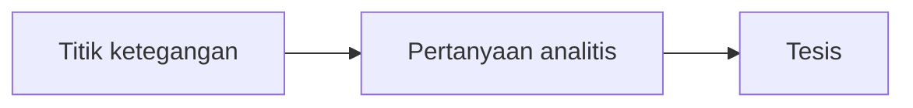

# Kiat-Kiat Menulis Catatan dan Esai

## Kita mulai dari…pertanyaan dasar

### Mengapa harus menulis?

Menulis adalah upaya merefleksikan gagasan yang ada di dunia batin ke dunia luar. Dengan menulis, gagasan yang mulanya hanya mendekam di dalam batin dikeluarkan menjadi objek yang bisa dikenali, yang terpisah dari diri penulis. Menulis, dengan demikian, adalah proses objektivikasi sekaligus penciptaan jarak antara penulis dan gagasannya.

Dengan adanya jarak tersebut, orang lain dapat mengenali apa yang menjadi gagasan si penulis sebagai objek yang terpisah. Bahkan penulis sendiri dapat membaca ulang pikirannya sebagai "yang lain". Penulis dapat memeriksa dirinya sendiri. Apa yang keliru dari yang pernah ia pikirkan, apa yang salah dari runtutan pikirannya. Penulis dapat merefleksikan dirinya di hadapan tulisannya sendiri.

Tanpa tulisan, sangat sulit bagi penulis untuk memeriksa isi pikirannya sendiri. 

## Bagaimana menulis catatan?

### Mengapa menulis catatan?

Buku-buku pemikiran seringkali memiliki gagasan yang sulit dipahami. Bahkan ada buku yang harus dibaca ulang berkali-kali untuk dapat dipahami, dan setiap kali membacanya, kita kerap berubah dari pemahaman satu ke pemahaman lainnya. Maka dari itu, menulis catatan tentang buku-buku menjadi penting. 

Dan pula, seperti telah dijelaskan tadi, menulis menciptakan jarak antara diri kita dan apa yang kita tulis. Dan menuliskan catatan dalam pembacaan pertama atas buku tertentu memungkinkan kita untuk memeriksa pemahaman, penafsiran dan refleksi yang kita miliki, serta mengoreksinya dalam pembacaan kedua dan seterusnya.

### Apa saja yang mesti dicatat?

Dalam buku pemikiran, sekurang-kurangnya terdapat sepuluh hal yang bisa dicatat:

- Mencatat istilah-istilah penting. Penulis terkadang tidak memberikan definisi dalam istilah tertentu, tapi cobalah untuk mendefinisikan istilah tersebut berdasarkan bagaimana penulis menggunakannya. Yang juga penting adalah bagaimana menerapkan definisi itu pada apa yang kita ketahui sebelumnya tanpa istilah-istilah tersebut.

   Khusus untuk Fajrul Islam, Ahmad Amin tidak memakai banyak istilah dalam menjelaskan gagasannya. Tetapi gagasannya sendiri dapat dicarikan padanan istilahnya hari ini.

- Mencatat distingsi antara bagian-bagian. Penulis kerap kali mengulang istilah dan pernyataan dalam bukunya, kadang juga mempertentangkannya dengan istilah dan pernyataan lainnya. Catat hubungan antara keduanya dan apa yang membuatnya berbeda satu sama lain, baik dalam pengulangan atau pertentangannya.

* Mencatat kesimpulan serta argumen-argumen penulis dalam menghasilkan kesimpulan tersebut.
  
* Mencatat bagian-bagian, istilah, klaim dan argumen yang penting pada buku, serta bagaimana relasi bagian-bagian tersebut dengan keseluruhan isi buku. Relasi ini akan lebih mudah dicerna dengan kita mengamati daftar isi dari buku dan pola-polanya.

* Mencatat secara ekspllisit bagian yang tidak kamu pahami dari buku. Ini penting sebab jika kamu tidak memahami isi dari bagian tersebut, setidaknya kamu memahami apa yang menjadi pertanyaanmu sehubungan dengan bagian tersebut. Dengan mengeksplisitkan pertanyaan, ia akan tertanam di ingatan dan dapat diperiksa kembali kemudian. Kamu juga akan selalu terdorong (tanpa lupa) membaca lebih giat untuk menjawab pertanyaan-pertanyaan tadi.

* Mencatat gagasan-gagasan pembanding yang mungkin muncul di kepalamu. Pemikiran dari satu penulis tertentu terkadang memiliki hubungan, baik secara langsung maupun tak langsung dengan pemikiran penulis lain. Hubungan ini bisa berupa perbandingan dan pertentangan, bisa juga berupa hubungan antargagasan, hubungan historis, hubungan kontekstual dst. Berdasarkan apa yang kamu ketahui, catat secara eksplisit gagasan pembanding serta hubungannya.

* Menulis ulang catatan yang masih kasar agar menjadi lebih halus. Usahakan menulis ulang catatan yang masih kasar dan sukar dipahami seolah-olah kamu ingin menyampaikannya ke sahabatmu.

* Menghapus catatan yang keliru. Adalah wajar bahwa pemahaman yang baru mengoreksi pemahaman yang lama. Jangan ragu untuk menghapus bagian-bagian yang keliru dari pemahaman lama — bahkan kalau bisa tulis ulang.

* menghubungkan catatan satu dengan lainnya dengan *id* dan tagar. Buat kode pengenal catatan satu dengan lainnya, misalnya berdasarkan bidang, tema, dst. Catatan juga dapat terhubung dengan catatan lain berdasarkan tagar. Misalnya catatan tentang gagasan penulis tertentu yang memiliki konteks invasi Perancis ke Kairo dapat terhubung dengan catatan tentang sejarah invasi Perancis melalui pemberian tagar `#invasiperancis` di kedua catatan tersebut.

* menghubungkan catatan satu yang tertaut pada buku dengan catatan lain yang berceceran. Terkadang sebuah catatan muncul dalam situasi yang tak terduga, dalam situasi di luar proses membaca buku. Catat dalam buku harianmu, dan hubungkan dengan buku yang sedang kamu baca.

## Bagaimana menulis esai?

### Mengapa harus esai?

Terdapat banyak bentuk tulisan. Tetapi dari sekian banyak itu, salah satu bentuk tulisan yang mempu menghadirkan dan mengembangkan perspektif penulis pada satu topik tertentu adalah esai. Melalui esai seseorang dapat membangun prosa yang terstruktur, yang terdiri dari tesis dan pembuktian-pembuktiannya.

Esai memiliki beragam bentuk. Ada esai ilmiah, ada pula esai bebas. Kadang esai juga dikategorikan berdasarkan bidangnya: esai filsafat, esai sastra, dst. Namun di antara semua ragamnya itu, setiap esai memiliki karakteristik yang sama. 

1. Gagasan yang terfokus pada satu tesis atau satu sudut pandang spesifik yang ingin dijelajahi oleh penulis. 
2. Kehadiran subjetivitas penulis. Semua esai memiliki si "aku" logis yang terekspresikan dalam bentuk gaya khas penulis yang sekurang-kurangnya mencakup: pilihan argumen dan cara berpikir penulisnya.
3. Struktur yang koheren. Semua esai ditulis dengan alur pengantar-isi-kesimpulan yang terhubung satu sama lain secara logis. Dengan struktur ini, penulis sebenarnya mencoba menuntun pembacanya mengikuti nalar penulis.
4. Sifatnya yang reflektif dan membuka ruang diskusi. Esai tidak bertujuan untuk mengakhiri perdebatan.

Yang akan kita tulis di Lakpesdam adalah esai ilmiah atau esai akademik.

## Sebelum menulis esai ilmiah

Dalam menulis esai ilmiah, kita dituntut untuk membuat tesis tertentu yang hendak kita buktikan serta memberikan penjelasan-penjelasan tentangnya. Menulis esai ilmiah adalah sebuah proses berpikir untuk menyampaikan secara sistematis apa-apa saja yang mendukung tesis kita. 

**Apakah itu tesis?**

Tesis adalah klaim utama di dalam esai. Yaitu gagasan utamamu sebagai penulis tentang masalah tertentu.

Tesis yang kuat biasanya adalah tesis yang dapat diperdebatkan (*argueable*) yang artinya pembaca mungkin saja tidak bersepakat dengannya. Oleh karena itu untuk mengembangkan tesis yang kuat ini dibutuhkan analisis bukti yang cermat sehingga sulit untuk dibantah.

### Bagaimana cara membangun tesis?

Kita hidup di kenyataan. Sementara itu, pengetahuan kita memiliki fungsi untuk memahami apa-apa saja yang ada di kenyataan. Dalam memahami kenyataan, kita melakukan praktik-teoretis yang bertumpu sekurang-kurangnya pada dua hal: 1) persepsi kita sendiri terhadap kenyataan, dan 2) pengetahuan yang ada sebelumnya.

Membangun tesis biasanya dimulai dengan pertanyaan-pertanyaan analitis yang muncul dari ketegangan-ketegangan yang kita tangkap. Dalam kajian literatur, yang itu menyangkut pengetahuan yang ada sebelumnya, kerap ditemukan beberapa ketegangan yang mungkin untuk diolah menjadi pertanyaan analitis, seperti berikut ini:

1. argumen yang tampak tidak meyakinkan,
2. inkonsistensi dan kekaburan dari argumen dan bukti,
3. kesimpulan tak terduga yang tampaknya kurang masuk akal,
4. kontroversi yang perlu dibahas lebih lanjut,
5. sesuatu yang diabaikan padahal itu perlu ditinjau lebih dalam.

Membangun tesis dimulai dari memunculkan pertanyaan-pertanyaan analitis terhadap titik ketegangan dari apa yang sudah kita baca dan pahami.

Pertanyaan analitis biasanya dimulai dengan pertanyaan ”mengapa” dan ”bagaimana”.

Contoh:

**Titik ketegangan:** Penjelasan Hasan as-Sa’ati, Sathi’ al-Hushri dan lain sebagainya tentang sosiologi Ibnu Khaldun terbatas pada dimensi empirisnya. Padahal lebih dari itu Ibnu Khaldun dalam teks-teksnya justru ingin membuktikan bahwa apa yang dia sebut sebagai sejarah, dan lebih dalam lagi umran, memiliki hukum-hukum umum dan mekanisme-mekanisme yang tak teramati. 

**Pertanyaan analitis:** bagaimana Ibnu Khaldun secara filosofis melampaui empirisisme yang dominan dalam penulisan sejarah di masanya?

**Tesis:** Ibnu Khaldun memikirkan sejarah dan gejala sosial bukan di atas asumsi empiris, tetapi di atas asumsi realis. 

### Menghimpun materi

Tesis yang jelas akan memberikan kepada kita batasan-batasan yang jelas pula dari subjek pembahasan yang hendak kita uraikan di dalam esai, serta materi-materi apa saja yang dapat mendukung pemahaman kita tentang subjek pembahasan tersebut. 

Dalam contoh sebelumnya, kita tidak perlu membahas semua tulisan yang mengulas pemikiran Ibnu Khaldun, tetapi cukup tulisan yang mengulas asumsi filosofisnya, terutama terkait sejarah di ranah epistemologisnya.

Setelah terhimpun, kita wajib melakukan tinjauan pustaka (meskipun tidak untuk dituliskan, ya). Kepustakaan dan materi-materi yang memiliki kaitan dengan subjek pembahasan mesti dilihat keterbatasan-keterbatasannya, sehingga dapat terungkap apa yang mampu kita lampaui dari materi-materi tersebut. Kebaruan (*novelty*) muncul dari sejauh mana kita meninjau materi yang sudah ada.

**Bagaimana jika subjek pembahasan yang akan kita uraikan ternyata telah ditulis oleh orang lain?**
 
- kita dapat melakukan pendekatan yang sama sekali berbeda dengan menggeser perspektif argumen pada tulisan tersebut.
- kita dapat memberikan kontribusi bagi pendekatan lama dengan menambahkan perspektif yang baru.

### Menulis outline

Sebagaimana telah disebutkan bahwa dalam menulis esai ilmiah, kita dituntut untuk membuat tesis tertentu yang hendak kita buktikan serta memberikan penjelasan-penjelasan tentangnya. Argumen-argumen yang mendukung tesis mestilah ditulis dengan runtut dan jelas. Dan tidak hanya itu, tetapi juga mesti dapat mengantarkan pembaca kepada kesimpulan dari tesismu. 

Untuk memudahkan gambaran awal tentang bagaimana esai akan ditulis, argumen-argumen utama dapat dituliskan terlebih dahulu dalam bentuk poin per poin. Misalnya dalam contoh sebelumnya, kita dapat membagi tesis menjadi dua dan beberapa tesis anakannya sebagai berikut:

- Ibnu Khaldun memikirkan sejarah dan gejala sosial bukan dalam asumsi empiris
    - Kritik Ibnu Khaldun terhadap sejarah yang empiris melalui dikotomi zahir/batin
    - Bagaimana contoh-contoh sejarah empiris yang dibantah oleh Ibnu Khaldun
    - Bagaimana zahir/batin menurut Ibnu Khaldun mesti dipahami dalam pengetahuan atas realitas sosial
- Ibnu Khaldun mengganti asumsi empiris sebagai pendekatan dominan dengan asumsi realis
    - Apakah itu realisme sebagai epistemologi dalam ilmu sosial
    - Bagaimana Ibnu Khaldun memikirkan gejala sosial di atas asumsi realis

Setiap poin outline pastikan berkaitan satu sama lain, mengalir dan logis. Jika perlu setiap alurnya juga ditulis sebagai anakan dari poin utama.

Jika terdapat gagasan-gagasan yang tidak nyambung dan patah, renungkan dan pikirkan kembali mengapa ia dituliskan di outline tersebut. Jika memang tidak beralasan, hapus saja.

Outline dapat selalu direvisi dalam proses menulis esai.

## Menulis…

Esai tersusun dari tiga bagian:

1. pendahuluan,
2. isi,
3. kesimpulan.

### Pendahuluan

Pendahuluan berfungsi untuk mengantar pembaca ke subjek pembahasan yang hendak diuraikan di esai.

Esai tidak perlu dibuka dengan *hook* yang dramatis atau *fun fact* yang memikat. Esai ilmiah dapat dibuka dengan penjelasan tentang latar belakang dari subjek pembahasan yang hendak dikaji dan  pertanyaan analitis yang menjadi asal-usul dari tesisme. Jika pertanyaan analitismu memang layak untuk dipecahkan, pembaca pasti akan tertarik untuk membaca lebih lanjut.

Setidaknya terdapat tiga poin berikut di dalam pendahuluan esai:

1. Informasi pengantar

   Di dalam esai, kita hanya akan menuliskan masalah yang spesifik. Pastikan pembaca memiliki pengetahuan yang cukup agar ia mampu mengikuti argumenmu di paragraf-paragraf berikutnya.

2. Pernyataan tentang pertanyaan analitikmu, yang dapat mengungkap kenapa orang perlu membaca esaimu

   Usahakan pertanyaan analitikmu memang layak untuk dikaji. Misalnya, hindari pertanyaan-pertanyaan yang memiliki jawaban yang sudah jelas, seperti ”mengapa Ibnu Khaldun dianggap sebagai sosiolog?”

3. Tesis

---

Berikut contoh pendahuluan:

> Ibnu Khaldun (w. 808 H/1406 M) menempati posisi yang khas dalam sejarah pemikiran Islam. Ia tidak hanya menuliskan sejarah, tetapi juga merumuskan kerangka epistemologis baru bagi ilmu sejarah itu sendiri. Ibnu Khaldun mengkritik tradisi penulisan sejarah yang berkembang di masanya, yang berhenti pada gejala-gejala sejarah yang teramati (empiris), tanpa upaya sistematis untuk menjelaskan hukum-hukum yang menggerakkan perubahan sosial. Tulisan ini hendak menguraikan secara filosofis bagaimana Ibnu Khaldun berupaya melampaui kecenderungan empirisisme tersebut. Melalui beberapa teksnya, Ibnu Khaldun justru melakukan patahan epistemologis dengan mengajukan asumsi-asumsi realis sebagai fondasi bagi pemahaman sejarah dan ilmu sosial.

### Isi

Isi mencakup rangkaian argumen yang dapat mengantar ke tesis esai.

Setiap paragraf dalam esai biasanya mencakup tiga unsur:

* Kalimat utama

  Kalimat utama berfungsi untuk menyatakan klaim dan memberikan sinyal kepada pembaca bagaimana paragraf terhubung dengan argumen yang lebih besar di dalam esai. 
  
* Bukti

  Bukti berisikan hal-hal yang menopang klaim kalimat utama. Dapat berisi kutipan dari sumber, data, atau argumen.
  
* Analisis

  Analisis berisikan apa yang kamu ingin pembaca pahami dari bukti-bukti tersebut.

---

Contoh:

> Di bagian awal *al-Muqaddimah*, Ibnu Khaldun menjelaskan bahwa penulisan sejarah pada masanya hanya berkutat pada pencatatan gejala sejarah yang tampak, yaitu menghimpun informasi-informasi “tentang peristiwa masa lalu”, berita tentang peperangan dan kerajaan. Lebih dari itu, Ibnu Khaldun juga mengkritik bahwa metode penulisan para sejarawan, hingga detik ia menuliskan pengantarnya, itu “miskin karakter dan penalaran”, repetitif, dan penuh dengan “taklid” kepada generasi sebelumnya. Oleh karena itu Ibnu Khaldun, di bagian berikutnya, memberikan definisi yang terang terkait problem: apakah itu sejarah sebagai disiplin ilmu.

### Menghubungkan paragraf

Bagaimana menghubungkan paragraf satu dengan lainnya tergantung pada ingin kamu bawa ke mana pembaca. 

- perbandingan dan kontras

  *begitu halnya, dengan cara yang sama, dengan cara yang serupa, sebaliknya, namun, di satu sisi, di sisi lain,* dst.
  
- persetujuan dan ketidaksetujuan

  *namun, meskipun demikian, terlepas dari, memang…namun, sebaliknya, namun demikian,* dst.

- sebab dan akibat

  *karena itu, karenanya, maka dari itu, akibatnya, dengan demikian, jadi,* dst.
  
- penjelasan dan uraian

  *dengan kata lain, misalnya, contohnya, khususnya, yaitu, untuk mengilustrasikan, selain itu*, dst.

- kesimpulan

  *kesimpulannya, sebagai hasilnya, pada akhirnya, secara keseluruhan, walhasil, dari situ*, dst.

## Takut salah?

Menulis dengan rapi dan bagus adalah menulis dalam tahapan revisi. Nah, bagaimana merevisi jika apa yang hendak direvisi saja belum ada?

Pada tahap awal, tulis esai apa adanya tanpa khawatir akan jadi bagus atau tidak esai tersebut. 

Tulis setiap argumen dengan tegas, berani, tanpa berputar-putar. 

Bayangkan pembacamu adalah orang-orang yang MALAS (oleh karena itu kamu harus menulis dengan jelas dan runtut), BODOH (oleh karena itu kamu harus menulis dengan sederhana) dan TIDAK TELITI (oleh karena itu kamu harus menulis dengan cara yang tidak ambigu dan membingungkan)

Hapus setiap bagian yang tidak relevan dengan tesismu.

## Baca kembali dan baca kembali

Baca kembali apa yang telah ditulis dengan pelafalan yang lantang. Itu akan memudahkan memilah mana yang seharusnya hendak disampaikan mana yang tidak. Jika apa yang ditulis dirasa tidak seharusnya disampaikan, maka hapuslah.

Jika kamu mengernyitkan dahi kebingungan, renungkan kembali tulisanmu mengapa kamu menuliskannya.

## Acak struktur tulisan

Mengacak struktur tulisan bisa dilakukan setelah tulisan keseluruhan sudah jadi. Atur ulang esai jika dirasa apa yang di akhir lebih tepat diletakkan di awal tulisan. Begitu pun sebaliknya.

Selalu tulis ulang tulisanmu saat melakukan revisi. 

Rehat sejenak barang satu atau dua hari (jangan terlalu lama, karena itu membuatmu lupa) kemudian kembali lagi ke tulisan. Jika kamu bertanya "mengapa bagian ini perlu ditulis?" dan tidak menemukan jawabannya, maka hapus saja.

Uji setiap keterbatasan dari argumen yang telah disusun. Usahakan pula untuk meminta temanmu membacanya. Itu akan lebih memudahkan dalam mengujinya.

Jika kamu tidak memahami tulisanmu, baca ulang kembali. Pastikan kamu paham dan menguasai apa yang kamu tulis. Pula, tinjau ulang outline yang sudah ditulis.

Jika hendak menambahkan ide baru, pikirkan apakah ide tersebut akan menjadi bagian penting dari tulisanmu atau tidak. Jika tidak, sebaiknya urungkan.

Pastikan kata-kata tepat sesuai konteks tulisan, kalimat sampai ke pembaca dan paragraf satu saling terhubung dengan paragraf lain.

## Lain-Lain

Bahan-bahan teknis dalam menulis

- [Panduan penulisan umum LTN](https://haret-rum.github.io/ltnnumesir/berkas/panduan-penulisan-umum)
- [Template esai dan makalah format docx.](https://haret-rum.github.io/ltnnumesir/berkas/unduh-template-makalah-dan-esai)
- [Menulis kutipan dengan Zotero](https://haret-rum.github.io/ltnnumesir/berkas/panduan-penyitiran-dengan-zotero)
- [Cara menulis huruf berdiakritik dengan *software*](https://haret-rum.github.io/ltnnumesir/berkas/penulisan-huruf-berdiakritik-dengan-software)

# Referensi

“Strategies for Essay Writing | Harvard College Writing Center.” Diakses 31 Juli 2026. https://writingcenter.fas.harvard.edu/pages/strategies-essay-writing.

“Guidelines on Writing a Philosophy Paper.” Diakses 31 Juli 2026. https://www.jimpryor.net/teaching/guidelines/writing.html.

Writing a Philosophy Essay | Writing Advice. t.t. Diakses 31 Juli 2026. https://advice.writing.utoronto.ca/types-of-writing/philosophy/.

“Peter Suber, ‘Taking Notes on Philosophical Texts.’” Diakses 31 Juli 2026. https://legacy.earlham.edu/~peters/courses/notes.htm.

Jesper, Steph. “Subject Guides: Note-Taking: A Practical Guide: Note-Taking.” Diakses 31 Juli 2026. https://subjectguides.york.ac.uk/note-taking/home.

# Sekian

