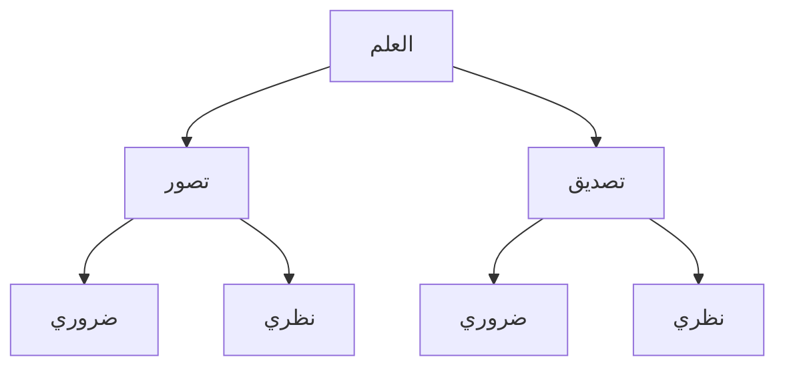
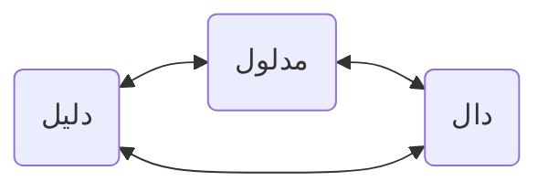
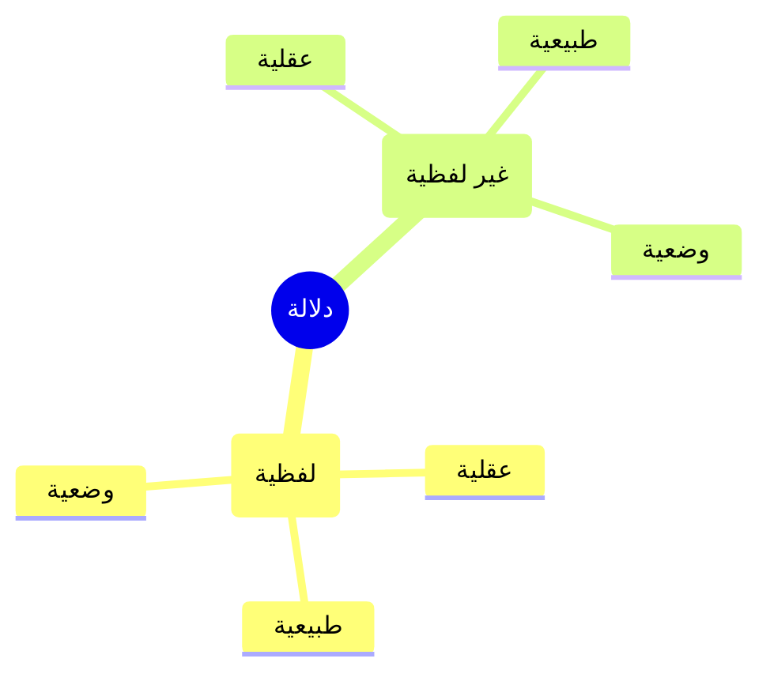
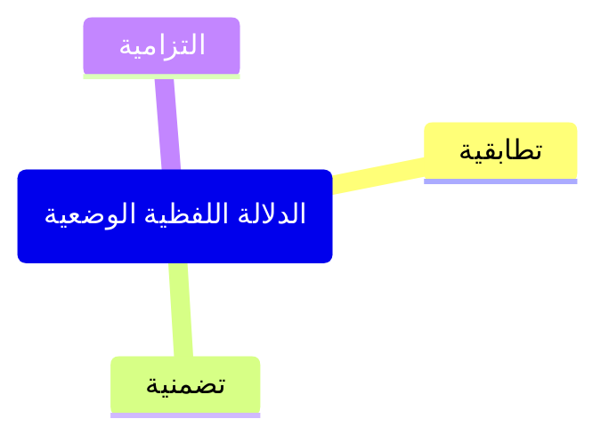

## Pembagian ilmu

Menurut Ahli Mantiq, ilmu dibagi menjadi dua

1. **Tashawwur (konsepsi):** menangkap makna mufrod
إدراك معنى مفرد

2. **Tashdiq (justifikasi):** menangkap makna berlakunya nisbat
إدراك معنى وقوع نسبة

Ad-Damanhuri mencontohkan dengan: 

> **"Zaid (adalah) berdiri"** 

Dalam konteks ini, membayangkan dan mengkonsepsikan kata "Zaid" di pikiran kita berarti tashawwur. Sedangkan memberikan justifikasi terhadap disandarkannya sifat berdiri kepada Zaid adalah tashdiq.  

---

Terdapat perbedaan antara hukama' (filsuf) dan madzhab imam ar-Razi dalam merumuskan apa itu tashawwur. Sementara **hukama menekankan perbedaan antara tashawwur dan tashdiq**, ar-Razi meleburkan keduanya. **Menurut ar-Razi, Tashdiq mencakup semua tindak tashawwur**, yang berlangsung dalam 4 tahap:

1. Tashawwur mawdu / mahkum (subjek) = "Zaid"
2. Tashawwur mahmul / mahkum alaih (predikat) = "Berdiri"
3. Tashawwur nisbat hukum = hubungan antara "Zaid" dan "Berdiri"
4. Tashawwur tetap tidaknya nisbat hukum di kenyataan (tashdiq)

Bagi hukama, tashawwur yang keempat disebut dengan tashdiq dan terpisah dari tindak tashawwur 1-3. Sementara itu, bagi ar-Razi keseluruhan tashawwur itulah dari 1-4 yang disebut **dengan tashdiq**. Oleh karena itu, tashdiq menurut hukama dapat dipahami secara sederhana (basith), sedangkan tashdiq menurut ar-Razi dapat dipahami secara bertingkat (murakkab) yang terdiri dari 4 tashawwur tersebut.

### Apakah yang dimaksud dengan nisbat hukum, dan apa perbedaannya dengan wuqu' nisbat hukum?

Nisbat hukum adalah hubungan yang dibangun antara subjek dengan predikat untuk menghasilkan keterkaitan logis. Contoh: langit adalah biru. Nisbat hukumnya adalah penetapan atau penyandaran sifat biru terhadap langit yang diwakili dengan kata "adalah". 

Sedangkan **Wuqu nisbat hukum** adalah proses mental (dzihni) yang menetapkan ada tidaknya nisbat hukum antara subjek dan predikat berdasarkan kesesuaiannya dengan kenyataan. Dalam contoh "Langit adalah biru" berarti kita menetapkan secara afirmatif/positif atribusi/pelekatan sifat biru terhadap langit dan menentukan  kesesuaiannya dengan kenyataan. Jika sesuai berarti benar, jika tidak sesuai berarti salah; di sini kita sedang berusaha melakukan tashdiq.

Nisbat hukum = hubungan antara maudhu dan mahmul yang diwakili dengan kata "adalah"
Wuqu' nisbat hukum = kesesuaian hubungan antara maudhu dan mahmul "Langit adalah biru" dengan kenyataan.

Mengapa pembahasan tashawwur di dalam ilmu mantiq didahulukan dari tashdiq? 

Karena **untuk menghasilkan tindak tashdiq, disyaratkan terlebih dahulu tashawwur** di setiap bagian pernyataan. Inilah yang disebut oleh muallif sebagai "Bi tha'b'". 

> [!IMPORTANT] Tambahan
> Jika penetapan itu sesuai dengan kenyataan, maka sebuah pernyataan disebut shadiq, sedangkan jika tidak maka disebut kadzib 
 
## Nazhari dan Dharuri

Masing-masing tashawwur dan tashdiq dibagi menjadi dua
1) nazhari (membutuhkan penyelidikan: berupa pengamatan, argumen dsb), 
2) dharuri (tidak membutuhkan penyelidikan).

> [!NOTE] Mudahnya!
> baik tashawwur dharuri maupun tashdiq dharuri dapat diketahui dengan:
> 1. Kebenarannya universal 
> 2. Dapat dipahami tanpa penyelidikan

**Tashawwur dharuri**
- Panas, dingin, wujud
- "Angka satu" dibayangkan sebagai angka ganjil
**Tashawwur nazhari**
- Manusia 
- Akal
**Tashdiq dharuri**
- Aksioma (pernyataan dasar) bahwa dua hal yang bertentangan tidak dapat berkumpul secara bersamaan. Misalnya: Buku itu bersampul sekaligus tidak bersampul. Pernyataan ini tanpa penalaran sudah terbukti keliru.
- Aksioma bahwa sebuah ciptaan menunjukkan adanya pencipta.
**Tashdiq nazhari**
- Pernyataan bahwa alam itu hadis (temporal). Untuk menetapkan keberlakuan nisbat dalam pernyataan tersebut membutuhkan penyelidikan lewat qiyas: 
	*alam itu berubah,* 
	*dan setiap yang berubah itu hadis* 
	*∴ alam itu hadis*

## Mabadi' Tashawwur dan Mabadi' Tashdiq

Titik berangkat (mabadi') tashawwur adalah 'kulliyatul khamsah' sedangkan titik akhirnya (maqashid) adalah 'qaul syarih'. Pembahasan 'qaul syarih' tidak dapat dipahami tanpa pemahaman kulliyatul khamsah. Karena untuk  sampai kepada maqashid, kita harus benar-benar memahami mabadi'. Demikian juga berlaku pada tashdiq. 

Titik berangkat tashdiq adalah 'qadhaya wa ahkamuha' dan titik akhirnya adalah 'qiyas wa aqsamuha'.

Adapun pembahasan tentang 'dalalah' dan 'lafadz' ditambahkan oleh para filsuf muslim, karena keduanya disyaratkan bagi pembahasan  'kulliyatul khamsah'. Karena mantiq berusaha membahas semua hal yang mungkin diketahui, sedangkan pengetahuan membutuhkan bahasa agar dapat dikomunikasikan, **maka pembahasan mantiq bergantung pada beres tidaknya pemahaman kita terhadap 'dalalah' dan 'lafadz'.**

## Dalalah (penandaan)

Dalalah adalah memahami sesuatu dari sesuatu yang lain

فهم أمر من أمر

Sesuatu yang kedua disebut **dal (penanda)** sedangkan sesuatu yang pertama disebut **madlul (petanda)**. Tindak memahami hubungan antara keduanya disebut **dalalah (penandaan)**. Dengan mengetahui kata "Langit" (dal) kita memahami objek yang ditunjuk dengan kata tersebut (madlul). 

Contoh lainnya: lampu merah (dal) menunjukkan (dalalah) perintah berhenti (madlul)

Namun definisi di atas mengandung kekeliruan karena mengandaikan penandaan bergantung pada ada tidaknya orang yang memahami. Sedangkan **menurut kelompok lainnya (al-Khubaishi, Qutbuddin ar-Razi, dsb) dalalah itu terkandung dan melekat pada dal** dan tidak bergantung pada ada tidaknya orang yang memahami. Oleh karena itu, kelompok terakhir mendefinisikannya dengan:

> كون الشيئ بحالة يلزم من العلم به العلم بشيئ اخر
>
> Adanya sesuatu berdasarkan kondisi tertentu (mis. kesepakatan/wadh'), pengetahuan tentang sesuatu tersebut berdampak pada dihasilkannya pengetahuan tentang sesuatu yang lain.

Dal dapat berupa lafadz (suara/verbal) dan bukan lafadz. Bisa jadi ia diketahui hanya dengan akal (ma'qulat), atau ia diketahui lewat tabiat manusia (thabiah), atau ia diketahui lewat kesepakatan atau konvensi (wadh') *{kondisi dal inilah yang disebut dalam ta'rif "بحالة"}*. Oleh karena itu dalalah berdasarkan penandanya dapat dibagi menjadi:

1. **Dalalah lafdhiyyah (verbal/suara)**
	1. **Thabi'iyyah**: suara "Ah" menunjukkan adanya reaksi kesakitan
	2. **Aqliyyah**: adanya pembicaraan di balik dinding menunjukkan terdapat beberapa orang di sana
	3. **Wadh'iyyah**: lafadz "Manusia" menunjukkan konsep hewan berpikir
2. **Dalalah ghairu lafdziyyah (non-verbal)**
	1. **Thabi'iyyah**: pipi merah menunjukkan rasa malu, wajah pucat menunjukkan rasa takut
	2. **Aqliyyah**: asap menandakan adanya api, bangunan menunjukkan adanya orang yang membangunnya
	3. **Wadh'iyyah**: mengangguk menunjukkan persetujuan, lampu merah menandakan berhenti.

Dalalah yang dikaji di dalam ilmu mantiq adalah dalalah lafdzhiyah wadh’iyyah. Terdapat beberapa alasan *mengapa hanya dalalah lafdziyah wadh'iyyah*: 
- seandainya dalalah tidak berupa lafadz atau berupa lafadz namun aspeknya thabi'ah atau aqliyyah, maka madlulnya bersifat acak dan tidak pasti, disebabkan fitrah dan akal manusia yang beragam dan berbeda satu sama lain. 
- Dalalah lafdziyyah wadh'iyyah dalam hal ini bahasa, adalah piranti sosial mendasar yang digunakan manusia untuk mengkomunikasikan pengetahuannya.

## Pembagian dalalah Wadh'iyyah

Dalalah lafdziyyah wadh'iyyah dibagi menjadi 3:
1. **Muthabaqiyyah**
	 lafadz menunjukkan kesesuaiannya secara utuh dengan makna. Contoh: “Manusia” menunjukkan keseluruhan dari konsep ‘hayawan natiq’.
2. **Tadhammuniyyah**
	lafadz menunjukkan sebagian maknanya. Contoh: “Rumah” dalam “Saya memperbaiki rumah” dapat menunjukkan hanya ke atap atau dinding atau lain sebagainya.
3. **Iltizamiyyah**
	lafadz menunjukkan sesuatu di luar makna lafadz tersebut namun melekat (lazim) padanya. Contoh: kata “Bapak” menunjukkan konsep anak. Angka satu (malzum) menunjukkan konsep ganjil (lazim) yang di luar esensinya namun melekat pada angka tersebut. Hubungan keduanya disebut luzum.

Lazim *berdasarkan kejelasannya (من حيث الوضوح)* dibagi menjadi:
   - **Bayyin-khusus**: begitu sebuah kata dipahami, secara langsung ia sudah selalu terhubung dengan sesuatu lainnya (lazimnya). Contoh angka “4” menunjukkan genap. “Bapak” menunjukkan anak. *Inilah yang disepakati ahli mantiq sebagai dal yang memiliki dalalah iltizamiyyah.*

| Empat  |   =   | Genap |
|:------:|:-----:|:-----:|
| Malzum | Luzum | Lazim |

   - **Bayyin-umum**: begitu sebuah kata dipahami, ia masih membutuhkan tasawwur lazim dan malzum agar keterhubungan antara keduanya (luzum) dapat diketahui. Contoh: kata “Manusia” menunjukkan kapasitasnya menerima ilmu.
   - **Ghairul Bayyin**: keterhubungan antara lazim dan malzum hanya dapat dipahami melalui perantaraan (seperti argumen, qiyas, deduksi, abduksi, dsb). Contoh: “Alam” menunjukkan kehudutsannya (dapat dipahami hanya melalui qiyas).

Lazim *berdasarkan mahal (من حيث محله)* dibagi menjadi:
- **Dzihni**: keterhubungan lazim dan malzum hanya ada di pikiran bukan di kenyataan. Contoh: "buta" menunjukkan "melihat".
- **Khariji**: keterhubungan keduanya hanya ada di kenyataan bukan di pikiran. Contoh: "gagak" menunjukkan "hitam".
- **Dzihni wa khariji**: keterhubungan keduanya ada di kenyataan dan di pikiran sekaligus. Contoh: "gunung" menunjukkan "lereng".
Buta - Melihat
Angka 1 - Ganjil
## Hubungan talazum di antara dalalah

| Hubungan                                              | penjelasan                                                                                                                                                                                                                                                                                                                     |
| ----------------------------------------------------- | ------------------------------------------------------------------------------------------------------------------------------------------------------------------------------------------------------------------------------------------------------------------------------------------------------------------------------ |
| muthabaqiyyah melekat pada iltizamiyyah               | muthabaqiyyah selalu talazum dengan dalalah iltizam karena sebuah lazim dari suatu kata mesti mengandaikan dalalah muthabaqiyyah yang menunjukkan makna utuh kata tersebut. Mis. Ketika mengatakan "Ganjil" langsung menandakan angka 1 dalam keutuhan maknanya                                                                |
| iltizamiyyah belum tentu melekat pada muthabaqiyyah   | iltizamiyyah belum tentu talazum dengan dalalah muthabaqiyyah karena sebuah kata dalam arti utuhnya belum tentu mengandaikan dalalah iltizamiyyah yang menandakan lazim dari kata tersebut, mis. Dengan alasan luzumnya masih belum jelas.                                                                                     |
| muthabaqiyyah melekat pada tadhammuniyyah             | muthabaqiyyah selalu talazum dengan dalalah tadhammuniyyah karena makna bagian dari suatu kata mesti mengandaikan dalalah muthabaqiyyah yang menunjukkan makna utuh kata tersebut. Mis. Ketika mengatakan "Berpikir" maka langsung langsung menandakan "Manusia" yang mencakup "Berpikir" sebagai bagian dari mafhum "Manusia" |
| tadhammuniyyah belum tentu melekat pada muthabaqiyyah | tadhammuniyyah belum tentu talazum dengan dalalah muthabaqiyyah karena sebuah kata dalam arti utuhnya belum tentu mengandaikan dalalah tadhammuniyyah yang menandakan bagian-bagian dari makna itu, mis. Kata "Jawhar" sebagai makna utuh, tidak dapat dibagi menjadi beberapa bagian.                                         |
| iltizamiyyah belum tentu melekat pada tadhammuniyyah  | iltizamiyyah belum tentu talazum dengan dalalah tadhammuniyyah karena sebuah kata yang menunjukkan lazimnya belum tentu mengandaikan dalalah thadammuniyyah yang menandakan bagian-bagiannya. Mis. "Membakar" yang menjadi lazim bagi api, belum tentu menandakan panas yang menjadi bagian dari api.                          |
| tadhammuniyyah - Iltizamiyyah                         | tadhammuniyyah belum tentu talazum dengan dalalah iltizamiyyah karena sebuah kata yang menunjukkan bagian-bagiannya belum tentu mengandaikan dalalah ltizamiyyah yang menandakan lazimnya. Mis. "Atap" yang menjadi bagian dari rumah, belum tentu menandakan arti aman yang menjadi lazim dari rumah.                         |
