---
aliases:
tags:
title:
author: Ahmad Faishol Abimanyu
---

Bab qadhiyah adalah pembahasan yang paling dasar untuk memahami jantung dari kajian  ilmu mantiq, yaitu qiyas. 

> [!quote]
> مركب احتمل الصدق والكذب لذاته. 
> 
> Definisi qadhiyah: qaul tersusun yang dapat dinilai benar dan salah pada dirinya sendiri.

hamliyyah

| **زيد** | **هو**                          | **كاتب** |     |
| ------- | ------------------------------- | -------- | --- |
| موضوع   | رابطة *عبارة عن* النسبة الحكمية | المحمول  |     |

syarthiyyah

| **إن**                                 | **كانت الشمس طالعة،** | **فـ**                                 | **النهار موجود** |
| -------------------------------------- | --------------------- | -------------------------------------- | ---------------- |
| اداة الشرط *عبارة عن* النسبة التلازمية | المقدم                | اداة الشرط *عبارة عن* النسبة التلازمية | التالي           |

| **والعدد إما زوج** | **وإما   **                        | **(هو) فرد** |
| ------------------ | ------------------------------------- | ------------ |
| المقدم             | اداة العناد *عبارة عن* النسبة التنافي | التالي       |

Qadhiyyah terdiri dari dua unsur yang saling dinisbatkan. Adakalanya 1) nisbat berupa pelekatan (haml) dan 2) adakalanya nisbat berupa talazum atau pertentangan (inad). Berdasarkan nisbat ini, qadhiyyah dibagi menjadi:

1) Hamliyyah (proposisi kategoris)
2) Syartiyyah (proposisi kondisional)
	1) Muttashilah (konjungtif)
	2) Munfashilah (disjungtif)

## Qadhiyah Hamliyah (Proposisi Kategoris)

Qadhiyah hamliyyah adalah qadhiyah yang mengandung maudhu dan mahmul.

> [!quote]
> ما اشتملت على موضوع ومحمول ؛ كزيد كاتب، إما أن يكون موضوعها كليا؛ كالإنسان حيوان، أو جزئيا؛ كزيد كاتب.

%%Contoh: maudhu-copula (predikasi)-mahmul
Rabithah:
- zamaniyyah كان
- ghairu zamaniyyah هو

َsusunan qadhiyah:
- tsunaiyyah = maudhu + mahmul
- tsulatsiyyah = maudhu + rabithah + mahmul
%%

| **زيد** | **هو**                          | **كاتب** |
| ------- | ------------------------------- | -------- |
| موضوع   | رابطة *عبارة عن* النسبة الحكمية | المحمول  |

| **الذهب** | **هو**                          | **معدن** |
| --------- | ------------------------------- | -------- |
| موضوع     | رابطة *عبارة عن* النسبة الحكمية | المحمول  |

dalam contoh di atas "emas" dihukumi sebagai "logam", atau dengan kata lain, emas dilekatkan/dibawai/disandari sifat ke-logam-an. Sedangkan kata "huwa" menjelaskan nisbat hukum antara "emas" dan "logam". dengan demikian kita dapat menyimpulkan bahwa qadhiyyah tersusun dari:

1. **Maudhu**' (subjek) yaitu "emas" sebagai hal yang diletakkan untuk dibawai sifat tertentu. dalam ilmu Nahwu, maudhu' juga disebut dengan mahkum alaih atau musnad ilaih.
2. **Mahmul** (predikat) yaitu "logam" sebagai hal yang dibawai/dilekatkan pada maudhu'. dalam ilmu Nahwu, mahmul juga disebut dengan mahkum bih atau musnad.
3. **Nisbat Hukum** yaitu hubungan antara maudhu' dan mahmul yang menyatakan ijab (positif/afirmatif) atau salab (negatif) dan dinyatakan dalam pelafalan;
4. **Rabithah** (kopula) yaitu ekspresi kebahasaan yang menjelaskan nisbat hukum. Dalam bahasa Arab ia bisa jadi dibuang atau berupa "huwa" atau adat nafi seperti لاو ليس dsb. Dalam Bahasa Indonesia ia dinyatakan dengan "adalah" "bukan" dan "tidak".

> [!tip] Catatan
> Jika rabithah dibuang, maka qadhiyyah hanya terdiri dari maudhu dan mahmul, oleh karena itu disebut dengan *Tsuna'iyyah*. Sedangkan jika rabithah diekspresikan, maka qadhiyyah terdiri dari maudhu, mahmul, dan rabithah, oleh karena itu disebut dengan *tsulatsiyyah*

Kata haml dalam hamliyyah berarti membawa. Dalam ilmu mantiq, **maudhu** adalah lafadz yang **diletakkan** pada qadhiyyah. Sedangkan **mahmul** adalah sifat yang **dibawai** di atas maudhu. Maksudnya sifat yang 'dilekatkan' pada maudhu.

> [!tip] Catatan
> Apa yang dimaksudkan dengan maudhu' adalah mashadaqnya atau afradnya
> 
> Apa yang dimaksudkan dengan mahmul adalah mafhumnya atau sifatnya

Ketika kita mengatakan "emas adalah logam", maka dengan kata lain kita berarti juga:

1. menempelkan sifat kelogaman terhadap emas sebagai objeknya
2. menempelkan mafhum logam terhadap mashadaq emas

Ketika kita mengatakan "manusia adalah hewan", maka kita juga berarti:

1. menempelkan mafhum hewan terhadap mashadaq manusia {zaid, bakar, umar, muhammad dst} = hewan
2. mengatakan bahwa sifat hewan itu benar dapat diterapkan pada {zaid, bakar, umar, muhammad dst} (الحيوان كمفهوم صدق على أفراد الإنسان)

Setiap logam dapat menghantarkan panas

Maka benar untuk mengatakan:
konsep menghantarkan panas berlaku atau dapat diterapkan pada semua afrad logam
	emas *dapat menghantarkan panas*
	besi *dapat menghantarkan panas*
	kuningan *dapat menghantarkan panas*
	tembaga *dapat menghantarkan panas*

## Pembagian Hamliyyah

Berdasarkan maudhu'nya qadhiyyah hamliyyah dibagi menjadi:

1. Syakhsyiyah (singular)
	1. Jika maudhu qadhiyah berupa juz'i
	2. Contoh: زيد كاتب
2. Muhmalah (tak-tentu)
	1. Jika maudhu berupa kulli namun tanpa sur
	2. Contoh: الإنسان حيوان 
3. musawwarah
	1. Kulliyah (universal)
		1. Jika maudhu berupa kulli dengan ur kullis (مسورة بالسور الكلي)
		2. Contoh: كل إنسان حيوان
	2. Juz'iyyah (partikular)
		1. Jika maudhu berupa kulli dengan sur juz'i (مسورة بالسور الجزئي)
		2. Contoh: 
		
-manusia adalah penyair-

sebagian manusia adalah penyair
semua manusia adalah penyair

Adapun yang dimaksud sur (السور/kuantor) adalah lafadz yang menunjukkan **kammiyyah (kuantitas)** afrad maudhu pada sebuah qadhiyyah; apakah keseluruhan atau sebagiannya. Jika keseluruhannya maka qadhiyyah disebut kulliyyah. Jika sebagiannya maka qadhiyyah disebut juz'iyyah.

> [!tip] Catatan
> Sebagian ahli mantiq juga menyebutkan bahwa terdapat macam lain, yaitu qadhiyyah thabi'iyyah. Qadhiyyah thabi'iyyah membahas maudhu' sebagai term-term logika, sebagaimana pernyataan "manusia adalah nau". Manusia diartikan sebagai kategori logika dan dalam pernyataan tersebut dihukumi sebagai syakhsiyyah

manusia adalah hewan
- manusia = {ziad, umar khalemuhammad dst}

Manusia adalah kata benda
- maudhu = manusia = mafhum/wataknya sebagai sebuah kata atau lafadz
- mahmul = kata benda = mafhum kata benda

(x) 
zaid ~~*adalah kata benda*~~
umar ~~*adalah kata benda*~~
khaled ~~*adalah kata benda*~~
muhammad ~~*adalah kata benda*~~

manusia adalah nau'
- maudhu = manusia = mafhumnya sebagai kulli

Masing-masing dari keempat pembagian di atas, dibagi kembali menjadi 1) mujabah: jika menunjukkan hubungan afirmatif (ijab) antara maudhu dan mahmul, dan 2) salibah: jika menunjukkan hubungan negatif (salab) antara maudhu dan mahmul. Kedua modus ijabah ataupun salibah dinamakan dengan **kayfiyyah (kualitas)** pada sebuah qadhiyyah.

semua manusia adalah hewan
- mafhum hewan dapat diterapkan ke seluruh afrad manusia

Semua manusia bukanlah batu
- konsep batu tidak dapat diterapkan ke seluruh afrad manusia 

hujan tidak turun
- sifat turun tidak diterapkan ke hujan

Mushannif tidak menjelaskan
- sifat menjelaskan tidak diterapkan pada mushonnif

Contoh

| كل                                | **الذهب** | **معدن** |
| --------------------------------- | --------- | -------- |
| سور (tercakup pada bagian maudhu) | موضوع     | المحمول  |

| ليس        | كل                                | **الذهب** | **معدن** |
| ---------- | --------------------------------- | --------- | -------- |
| أداة السلب | سور (tercakup pada bagian maudhu) | موضوع     | المحمول  |

Berdasarkan pembagian yang sudah kita lakukan, maka dihasilkan 8 jenis qadhiyyah hamliyah. Yaitu syakhsiyyah mujabah, syakhsiyyah salibah, muhmalah mujabah, muhmalah salibah, kulliyah mujabah, kulliyah salibah, juz'iyyah mujabah dan juz'iyyah salibah.

> [!tip] Catatan
> Jika sur menentukan kammiyah sebuah qadhiyyah, ijab/salabnya menentukan kayfiyyah sebuah qadhiyyah.
> 
> كل الإنسان حيوان
> 
> apakah kammiyyahnya? 
> j: Kulliyyah, karena yang diacu oleh manusia adalah keseluruhan afradnya
> apakah kaifiyyahnya?
> j: Mujabah, karena nisbat antara maudhu dan mahmulnya adalah ijabi (positif)

Jika kita memperhatikan contoh salibah di atas, kita dapat menyimpulkan bahwa adat salab menjadi ibarat yang menjelaskan hubungan antara maudhu dan mahmul. Ia adalah rabithah. Namun adat salab juga dapat diletakkan pada maudhu' ataupun mahmul, meskipun **tidak mengubah** pernyataan  mujabah  menjadi salibah, atau sebaliknya. Qadhiyyah yang adat salabnya digeser dinamakan qadhiyyah ma'dulah. Sedangkan jika tidak demikian maka dinamakan muhasshalah. Contohnya

**hakiki**
jism - jenis baid
	jism namy - jenis wast
		hewan - jenis qarib
			manusia - nau'
				
				zaid (bukanlah kulli)

**Idhafi**

Apakah itu zaid?
adalah manusia yang bernama zaid.

tindakan
- ibadah = tindakan + fashl (niat lillah)
	- solat
	- zakat
	- dst
- bukan ibadah = tindakan + fashl (tidak diniatkan)

apakah itu hewan?

j: jenis qarib + fashl
jism namy hay

genus
- species

qadhiyah muhassholah
manusia bukanlah batu
(maudhu) (adat nafy) (mahmul)

Ma'dulah
non-manusia adalah batu ⇒ mujabah
(maudhu+nafy) (mahmul)

اللاإنسان هو حجر

manusia adalah non-batu ⇒ mujabah
(maudhu') (mahmul+nafy)

non-hewan adalah non-manusia

لا شيء مما هو **لا حيوان** بإنسان (qadhiyah ma'dulat maudhu)

hewan X non-hewan (naqidh)

كل إنسان هو **لا فرس** (ma'dulat mahmul)

kuda X non-kuda

كل ما **لا حيوان** هو **لا إنسان** (ma'dulat tharafain)

manusia X non-manusia

Contoh muhasshalah

كل مجتهد ناجح

ولا شيء من الجهاد بإنسان

> [!quote]
> (١) **السور الكلى فى الإيجاب** وهو كل، وجميع، وعامة، وكافة، وغيرها من كل لفظ يدل على ثبوت المحمول لجيع أفراد الموضوع؛ وذلك نحو كل مثلث يحتوى على ثلاثة أضلاع، جيع المعادن تتمدد بالحرارة، عامةالمصرين محبون أميرهم 
> (٢) **السور الكلى فى السلب** وهو لاشى، ولا واحد، والنكرة فى سياق النفى وغيرها من كل ما يدل على عموم سلب الحكم عن جيع أفراد الموضوع؛ وذلك نحو لاشيء من الجماد بحي، ولا واحد من الطلبة حاضر 
> (٣) **السور الجزئي فى الايجاب** وهو بعض، وواحد، وكثير، وقليل، ومعظم وغيرها من كل لفظ يدل على ثبوت المحمول لبعض أفراد الموضوع فقط ؛ وذلك نحو بعض المثلث قائم الزاوية ، وواحد من الحاضرين يتكلم ، وقليل من المصريين سافر إلى أوربا
> (٤) **السور الجزئى فى السلب** وهو ليس بعض ، وليس كل ، وليس جميع ، وبعض. . . ليس، وما كل ، وغيرها من كل لفظ دل على سلب المحمول عن بعض أفراد الموضوع فقط، وذلك نحو ليس بعض المثلثات بقائم الزاوية ، وليس كل المصريين بمتعلم، وبعض الطلبة ليس منتسبا إلى الأزهر

Dalam bab qiyas nanti, syakhsiyyah dihukumi sebagai kulliyyah, karena ketika menyatakan "zaid memukul" berarti keseluruhan diri zaid yang dihukumi. sedangkan muhmalah dihukumi sebagai juz'iyyah karena hukum belum tentu diterapkan pada keseluruhan. maka di pembahasan qiyas, hanya akan ada 4 qadhiyyah yang dikaji:

1. kulliyyah mujabah (A)
2. juz'iyyah mujabah (I)
3. kulliyyah salibah (E)
4. juz'iyyah salibah (O)

untuk memudahkan kita dapat mempersingkatnya menjadi simbol (Affirmo dan Nego) secara berurutan menjadi A, I, E, O.

> [!NOTE]
> hubungan antara mashadaq dengan mafhum dalam sebuah qadhiyyah
> 
> *الانسان حيوان*
> mafhum hewan {organisme hidup} → mashadaq manusia {zaid, khalid, muhammad, dst}
> *Santri ppfm Resikan* 
> mafhum resikan {disiplin bebersih diri} → mashadaq santri ppfm {santri kelas diniyah dari idad - dewan asatidz}

```mermaid
flowchart RL

    n1["أقسام الحملية <br>"] --> n2["باعتبار نسبتها<br>"] & n3["باعتبار موضوعها<br>"]

    n2 --> n4["موجبة"] & n5["سالبة"]

    n3 --> n6["شخصية"] & n7["مهملة"] & n8["مسورة"] & n9["طبيعية"]

    n8 --> n10["كلية"] & n11["جزئية"]

  

    n1@{ shape: rect}

     n1:::Pine

     n2:::Aqua

     n3:::Aqua

    classDef Pine stroke-width:1px,stroke-dasharray:none,stroke:#254336,fill:#27654A,color:#FFFFFF

    classDef Aqua stroke-width:1px,stroke-dasharray:none,stroke:#46EDC8,fill:#DEFFF8,color:#378E7A

    classDef Rose stroke-width:1px,stroke-dasharray:none,stroke:#FF5978,fill:#FFDFE5,color:#8E2236

    style n1 stroke:#000000
```

